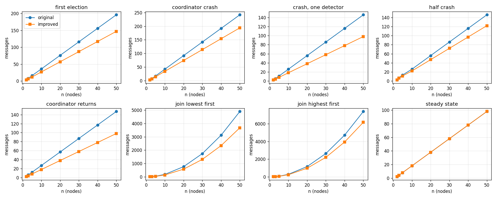
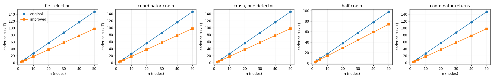
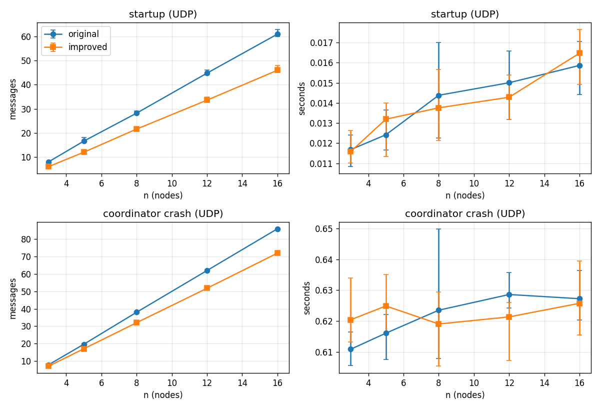

# P1: Leader Election

Garcia-Molina's **Bully** election algorithm [1] and an improved variant that
sends fewer messages. Both are implemented, tested, deployed one node per container, and
compared in experiments.

## Contents

| Path | Contents |
|---|---|
| [bully/](bully) | The algorithms ([original.py](bully/original.py), [improved.py](bully/improved.py), shared [node.py](bully/node.py)), the state vector and safe storage, two transports (in memory and UDP), the entry point [\_\_main\_\_.py](bully/__main__.py), and [simulation.py](bully/simulation.py) for running many nodes in one process |
| [tests/](tests) | Unit tests, system tests in memory and over UDP, safety tests with random faults, and tests of the experiments |
| [experiments/](experiments) | The comparative experiments; their output is in [results/](results) |
| [docs/](docs) | The paper's notes ([bully-ref1.md](docs/bully-ref.md))  and the UML diagrams ([figures/](docs/figures)) |
| [Dockerfile](Dockerfile), [docker-compose.yml](docker-compose.yml), [k8s/bully.yaml](k8s/bully.yaml) | One node per container |

## Running it

```bash
pip install -r requirements-dev.txt     # pytest and matplotlib; the algorithms need only Python 3.12
python -m pytest                        # all tests, about 20 seconds
python -m experiments.run               # all experiments, about 3 minutes; --no-udp for a 1-second run
```

### Docker Compose

```bash
docker compose up --build               # node 5 becomes coordinator
docker compose stop node5               # node 4 takes over
docker compose start node5              # node 5 bullies its way back
```

Each node logs what it does and why. After `docker compose stop node5`:

```text
[node 4] -> AreYouThere to node 5: no answer
[node 4] ELECTION: running its own election
[node 3] <- Halt from node 4
[node 3] ELECTION: halted by node 4, waiting for it
[node 4] -> Halt to node 3: ok
...
[node 4] REORGANIZATION: coordinator, announcing to nodes [1, 2, 3]
[node 3] <- Ready from node 4
[node 3] NORMAL: node 4 is coordinator
[node 4] NORMAL: coordinator of nodes [1, 2, 3, 4]
```

A node that stops prints its totals, e.g. `stopped; sent 28 messages (AreYouNormal 20, Halt 4, Ready 4), 0 unanswered`.
The routine heartbeats are hidden; `BULLY_LOG_LEVEL=DEBUG docker compose up` shows them too.
`BULLY_ALGORITHM=original` switches algorithm.

The containers are configured through environment variables:

| Variable | Meaning | Default |
|---|---|---|
| `BULLY_ID` | this node's id, 1..n (on Kubernetes taken from the pod name: `bully-3` is node 4) | |
| `BULLY_N` | number of nodes | |
| `BULLY_ALGORITHM` | `original` or `improved` | `improved` |
| `BULLY_PEERS` | address template, `node{id}:9000` or `bully-{ord}.bully:9000` | |
| `BULLY_PORT` | UDP port to listen on | `9000` |
| `BULLY_STATE_DIR` | folder for the safe storage | `/data` |
| `BULLY_TIMEOUT` | the bound T, in seconds | `1.0` |
| `BULLY_LOG_LEVEL` | `INFO`, or `DEBUG` to also show heartbeats | `INFO` |

### Kubernetes

```bash
docker build -t bully-election .        # load it into your cluster, e.g. kind load docker-image
kubectl apply -f k8s/bully.yaml
kubectl logs -f bully-0                 # watch it
kubectl delete pod bully-4              # the coordinator (node 5) crashes; the StatefulSet restarts it
```

## The two algorithms

Both follow Garcia-Molina's Bully algorithm for the strict environment (Assumptions 1-9 in
[bully-ref1.md](docs/bully-ref.md)). A node that notices a problem probes every higher node;
if none answers, it halts every lower node, and then announces itself.

| | Messages to the i - 1 lower nodes | States of a lower node |
|---|---|---|
| **Original** ([original.py](bully/original.py)) | Halt, NewCoordinator, Ready: **3(i - 1)** | Election -> Reorganization -> Normal |
| **Improved** ([improved.py](bully/improved.py)) | Halt, Ready: **2(i - 1)** | Election -> Normal |

The improved variant merges NewCoordinator into Ready. Once the Halt round is over, the
coordinator already knows the task, so one message can announce both the coordinator and the
task. Halt stays a separate step, and the guard that protects NewCoordinator in the original
(`s = Election and h = sender`) moves to Ready. That way, a message from an election that has
since been superseded is still rejected. Everything else is shared through
[node.py](bully/node.py).

## Verification

- **Unit tests** cover every module: state, storage, both transports, the handlers and their
  guards, configuration and logging.
- **System tests** run whole clusters: in memory (crashes, recoveries, and races where a node
  recovers in the middle of another node's election), and over real UDP sockets with
  `__main__.serve`, as in the containers.
- **Assertion 1 at every instant.** Every in-memory cluster has a `SafetyMonitor`
  ([simulation.py](bully/simulation.py)) that checks the paper's safety condition after *every*
  state change of *every* node. Every system test therefore checks safety continuously, not only
  at the end.
- **Random faults** ([test_safety.py](tests/test_safety.py)): 200 random histories per algorithm,
  with crashes and recoveries injected in the middle of elections. Assertion 1 must hold
  throughout, and Assertion 2 (everyone agrees on the highest live node) must hold once the
  faults stop.
- **The experiments are tested too** ([test_experiments.py](tests/test_experiments.py)): the
  measured counts must equal closed-form formulas, for example 4(n - 1) against 3(n - 1)
  messages for a first election.

## Results

Generated by `python -m experiments.run`. Full tables are in
[results/summary.md](results/summary.md), and the raw data in
[results/in_memory.csv](results/in_memory.csv) and [results/udp.csv](results/udp.csv).

**In memory** (exact, repeatable counts; n = 2 to 50) covers eight scenarios:
first election, coordinator crash, crash noticed by a single node (best case), half the nodes
crashing, the coordinator returning, nodes joining one by one lowest first (worst case) and
highest first, and the steady state with no failure.



| Scenario (n = 50) | Original | Improved | Saved | Growth |
|---|---|---|---|---|
| first election | 196 | 147 | 25% | ~ n |
| coordinator crash | 242 | 194 | 20% | ~ n |
| crash, one detector | 146 | 98 | 33% | ~ n |
| half crash | 146 | 122 | 16% | ~ n |
| coordinator returns | 147 | 98 | 33% | ~ n |
| join lowest first | 4900 | 3675 | 25% | ~ n^2 |
| join highest first | 7399 | 6174 | 17% | ~ n^2 |
| steady state (one check interval) | 98 | 98 | 0% | ~ n |

**Election time.** A leader makes its calls one after another, and each takes at most T. The
number of calls the new leader makes is therefore an upper bound on the election time, in
units of T: 3(n - 1) for the original against 2(n - 1) for the improved variant, in a first
election.



**Over UDP** (n = 3 to 16, 5 repetitions, T = 0.2 s, check interval 0.2 s), every node runs in
its own thread, so elections really overlap. After a coordinator crash at n = 16, the original
sends 86 messages and the improved variant 72. Both agree on the new leader after about
**0.6 s** (0.61-0.65 s in every run): up to one check interval to notice, plus T for each of the two unanswered probes
of the dead coordinator.



**Correctness during the experiments.** Assertion 1 was checked 59,197 times and never failed.
All 228 runs elected the highest live node.

### What the results show

1. **Messages per election grow linearly in this Bully algorithm**, both in the best and the
   worst single-failure case. The textbook Bully algorithm has an O(n^2) worst case, but this
   one doesn't: a node that gets an answer from a higher node simply waits, instead of making
   that node start an election of its own. The price is time, because the waiting node depends
   on the higher node's own timeout.
2. **The improved variant saves exactly one message per lower node per election.** That is
   16-33% of all messages, depending on how many are spent on failure detection. In the steady
   state, where only failure detection runs, it saves nothing.
3. **Joining is the expensive case for both: O(n^2) messages.** Every join causes a full
   election. When nodes join lowest first, each new node is the new highest and takes over.
   When they join highest first, the coordinator's `Check` notices each newcomer, and the
   coordinator halts everyone again.
4. **Failure detection is a large, fixed cost.** It takes 2(n - 1) messages per check interval
   for both variants. In a crash, about half of all messages are detection messages.
5. **Time is dominated by detection and timeouts, not by the election rounds.** Both variants
   have the same number of unanswered messages (each costing a full T) and the same recovery
   time over UDP. The improved variant's shorter election, 2(i - 1) instead of 3(i - 1)
   sequential calls, only becomes visible when message delays are large compared to the check
   interval and T. On localhost a round trip takes well under a millisecond.
6. **Space is the same for both:** O(n) per node, for the `Up` set and the participants in the task.

### Comparing with other leader election algorithms

| This project measures | Corresponds to | Typical figure in the literature |
|---|---|---|
| election messages for one failure (Halt, NewCoordinator, Ready) | messages per election | textbook Bully: O(n^2) worst case. Ring (Chang-Roberts): O(n log n) average, O(n^2) worst. Raft: one RequestVote round, about 2(n - 1) per attempt, plus retries after split votes. ZooKeeper FLE: O(n^2) vote notifications |
| steady state | failure-detection overhead per interval | Raft: n - 1 heartbeats (AppendEntries) per heartbeat interval |
| join scenarios | leader stability when nodes join | Raft: a joining node does not trigger an election. Bully: every join does |
| leader calls (x T), UDP seconds | election time | Raft: election timeout (150-300 ms in the paper) plus one round trip |

## References

1. Hector Garcia-Molina. “Elections in a Distributed Computing System”. *IEEE Transactions on Computers*, C-31.1 (1982), pp. 48–59. Found at bully-ref.md
