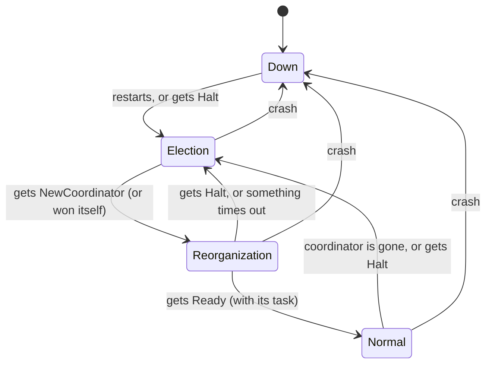
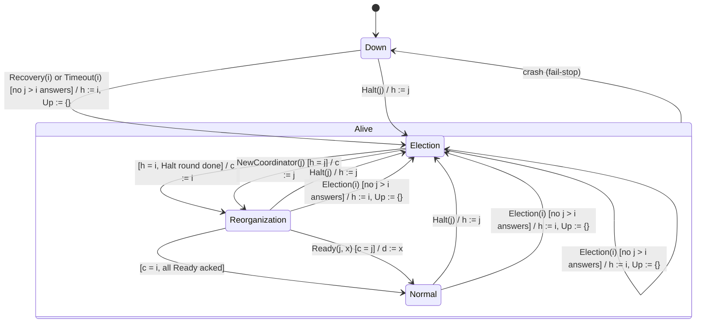

# State machine: original Bully algorithm

Each node is always in one of four states. The editable diagrams are in [state-machine.drawio](state-machine.drawio), on the pages "Bully (simple overview)" and "Bully (detailed)".

| State | What it means |
|---|---|
| **Down** | The node has crashed or has just restarted |
| **Election** | The node is paused and waits to learn who won |
| **Reorganization** | The node knows the new coordinator but has not received its task yet |
| **Normal** | The node is working on its task |

## How one election goes

The node with the highest ID wins. That is why it is called "Bully".

1. Node `i` notices the coordinator is gone, or `i` has just restarted.
2. `i` asks every node with a **higher** ID: "are you there?"
   - If someone answers, `i` gives up and waits. The higher node takes over.
   - If nobody answers, `i` has won.
3. The winner sends **Halt** to every lower node. They stop and go to **Election**.
4. The winner sends **NewCoordinator**. They go to **Reorganization**.
5. The winner sends **Ready** with the task. Everyone goes to **Normal**.

## Detailed version

Each node stores a few variables that survive a crash:

| Variable | Meaning |
|---|---|
| `s` | The current state: Down, Election, Reorganization or Normal |
| `c` | Who this node thinks the coordinator is (`c = i` means "me") |
| `d` | The task this node has been given |
| `h` | Who halted this node most recently |
| `Up` | The winner's list of lower nodes that answered its Halt |

Labels use UML notation `event [condition] / action`.

- **Election(i) is called by** `Recovery(i)` after a restart, by `Timeout(i)` when the coordinator stops responding, by `Check(i)` when the coordinator finds a node that is not Normal, and after a timeout while the winner sends `NewCoordinator` or `Ready`.
- **If a higher node answers**, `Election(i)` returns without changing `s`. Node `i` waits to be halted, and `Timeout(i)` retries if no coordinator appears.
- **The conditions on the arrows are required.** `NewCoordinator(j)` is accepted only if `h = j`, and `Ready(j, x)` only if `c = j`. Otherwise the message is ignored, so a message left over from an abandoned election cannot move a node forward.
- **In every Alive state** the node answers `AreYouThere(j)` and `AreYouNormal(j)` without changing state.
