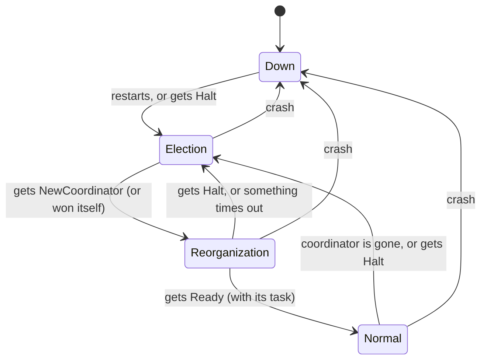

# State machine: original Bully algorithm

Each node is always in one of four states. The editable diagram is in [state-machine.drawio](state-machine.drawio).

| State | What it means |
|---|---|
| **Down** | The node has crashed or has just restarted |
| **Election** | The node is paused and waits to learn who won |
| **Reorganization** | The node knows the new coordinator but has not received its task yet |
| **Normal** | The node is working on its task |

## How one election goes

The node with the highest ID wins. That is why it is called "Bully".

1. Node `i` notices the coordinator is gone, or `i` has just restarted.
2. `i` asks every node with a **higher** ID: "are you there?"
   - If someone answers, `i` gives up and waits. The higher node takes over.
   - If nobody answers, `i` has won.
3. The winner sends **Halt** to every lower node. They stop and go to **Election**.
4. The winner sends **NewCoordinator**. They go to **Reorganization**.
5. The winner sends **Ready** with the task. Everyone goes to **Normal**.
