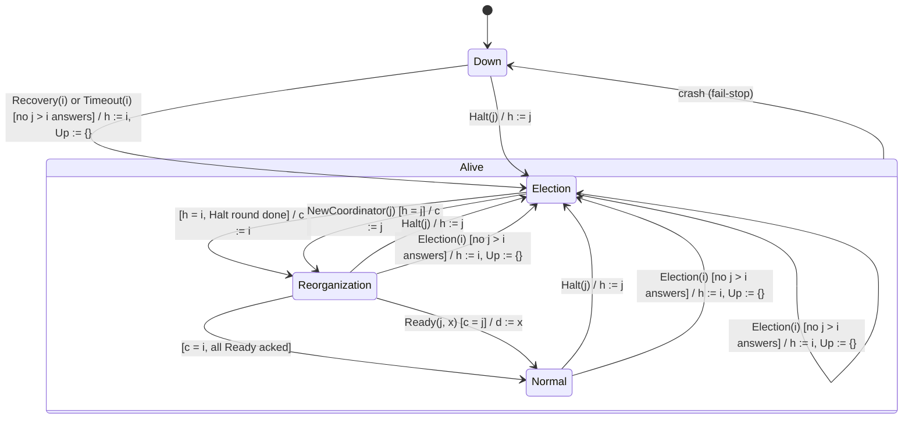

# State machine: original Bully algorithm

This diagram shows the status field `S(i).s` of a single node `i`, as described in Garcia-Molina (1982) and summarised in [bully-ref1.md](../bully-ref1.md).
The editable UML version is in [state-machine.drawio](state-machine.drawio) on the page "Bully (original)".

## States

| State | Meaning | Activity of node `i` |
|---|---|---|
| **Down** | Crashed, or restarted but not yet in a group | On restart, `Recovery(i)` sets `h := undefined` and calls `Election(i)` |
| **Election** | Halted. All processing is stopped | `entry / STOP`. If `h = i`, it sends `Halt(k, i)` to every `k < i` and adds each node that answers to `Up`. If `h = j`, it waits for `NewCoordinator(j)` |
| **Reorganization** | The coordinator is agreed, but the task is not yet known | If `c = i`, it sends `NewCoordinator(k, i)` to every `k ∈ Up`, computes `d`, then sends `Ready(k, i, d)` to every `k ∈ Up`. If `c = j`, it waits for `Ready(j, x)` |
| **Normal** | Executing task `d` | If `c = i`, `Check(i)` periodically polls `AreYouNormal`. If `c ≠ i`, `Timeout(i)` probes the coordinator |

## Rules shown in the diagram

- **Election(i) is called by** `Recovery(i)`, by `Timeout(i)` when the coordinator stops responding, by `Check(i)` when some node is not Normal, and after any Part 2 timeout (a `NewCoordinator` or `Ready` call that was not acked).
- **Part 1 can fail.** If any `j > i` answers `AreYouThere`, `Election(i)` returns without changing `s`. Node `i` then waits for the higher node to halt it, and `Timeout(i)` retries if no coordinator appears.
- **Halting and announcing are separate steps.** `Halt` puts every lower node into an inert `Election` state before anyone is told the result. This keeps Assertion 1 true at every moment.
- **The guards are required.** `NewCoordinator(j)` is accepted only when `s = Election ∧ h = j`, and `Ready(j, x)` only when `s = Reorganization ∧ c = j`. Otherwise the message is ignored, so a message left over from an abandoned election cannot move a node forward.
- **Internal transitions in every Alive state:** `AreYouThere(j)` is answered with a reply, and `AreYouNormal(j)` is answered with `s = Normal`.
- **A crash can happen in any Alive state** and always leads to Down (fail-stop, Assumption 5).
